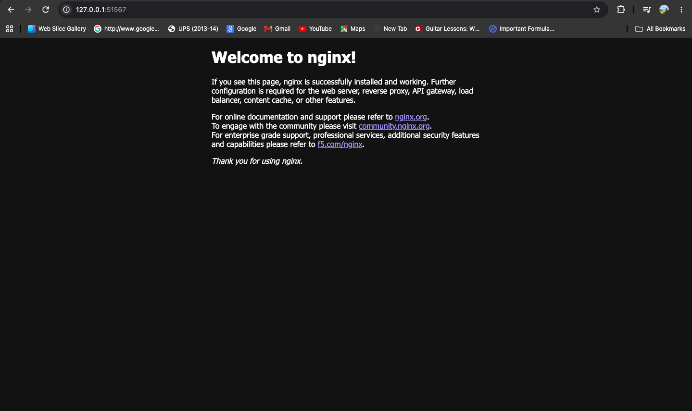
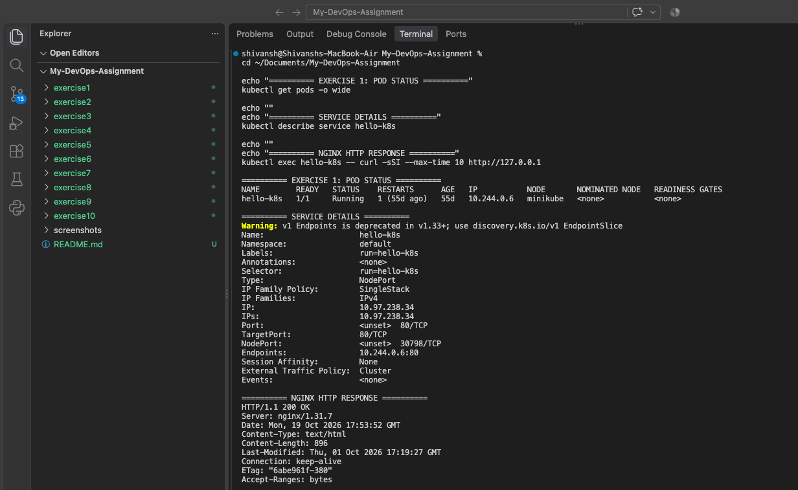

# Exercise 1 — Kubernetes Getting Started

## Objective

Deploy an Nginx Pod on Kubernetes using Minikube, expose it through a
NodePort Service, and verify that the Nginx welcome page is accessible.

---

## Final Result

The Nginx application was successfully deployed on the Minikube cluster.
The Pod reached the Running state, and the application was accessible
through the Kubernetes Service.



---

## Commands Executed

The following commands were used to verify the Pod, inspect the Service,
and access the Nginx application.

```bash
kubectl get pods
kubectl get services
kubectl wait --for=condition=Ready pod/hello-k8s --timeout=60s
kubectl describe service hello-k8s
kubectl exec hello-k8s -- curl -I --max-time 10 http://127.0.0.1
minikube service hello-k8s
```



---

## Files Created

- `nginx-pod.yaml` — Kubernetes Pod manifest for Nginx.
- `nginx-service.yaml` — NodePort Service manifest.
- `readme.md` — Exercise documentation.

---

## Application Verification

The Nginx server returned an HTTP `200 OK` response, confirming that
the web server was responding successfully inside the Pod.

---

## Conclusion

Successfully deployed and verified an Nginx application using Kubernetes
and Minikube, and exposed it through a NodePort Service.
