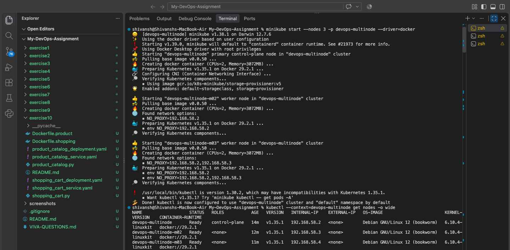
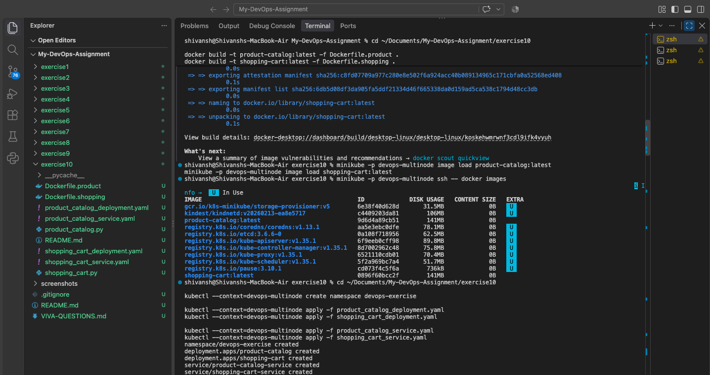
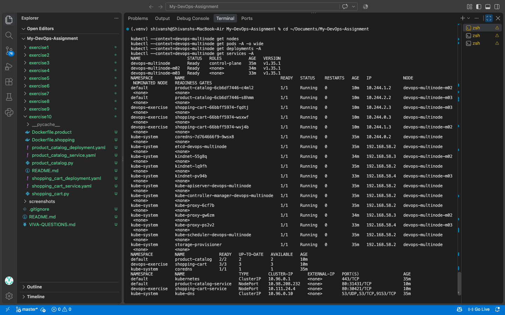

# Exercise 10: Multi-Node Kubernetes Deployment

## Objective
Deploy two Flask applications on a three-node Minikube cluster with replicas distributed across nodes.

## Applications
- **Product Catalog:** `GET /products` returns Laptop, Phone, and Headphones.
- **Shopping Cart:** `GET /cart` retrieves cart contents; `POST /cart` adds an item.
- Both applications expose `/health` for Kubernetes readiness probes.

## Docker images
- `product-catalog:latest` — built using `Dockerfile.product`.
- `shopping-cart:latest` — built using `Dockerfile.shopping`.
- Both images were loaded into the `devops-multinode` Minikube cluster.

## Kubernetes deployment
- Cluster: `devops-multinode` with three Ready nodes.
- Product Catalog: 2 replicas in the `default` namespace.
- Shopping Cart: 3 replicas in the `devops-exercise` namespace.
- Both Deployments use required pod anti-affinity to distribute their replicas across separate nodes.
- Services: `product-catalog-service` and `shopping-cart-service`, both NodePort.

## Verification results
| Check | Result |
|---|---|
| Kubernetes nodes | 3 Ready |
| Product Catalog Deployment | 2/2 available |
| Shopping Cart Deployment | 3/3 available |
| Product Catalog GET /products | HTTP 200; three products returned |
| Shopping Cart initial GET /cart | HTTP 200; empty list returned |
| Shopping Cart POST /cart | HTTP 201; laptop added |
| Shopping Cart updated GET /cart | HTTP 200; added item returned |

## Commands used for verification
```bash
kubectl --context=devops-multinode get nodes -o wide
kubectl --context=devops-multinode get pods -A -o wide
kubectl --context=devops-multinode get deployments -A
kubectl --context=devops-multinode get services -A
curl -i http://127.0.0.1:8081/products
curl -i http://127.0.0.1:8082/cart
curl -i -X POST http://127.0.0.1:8082/cart -H "Content-Type: application/json" -d "{\"id\":1,\"name\":\"Laptop\",\"quantity\":1}"
```

## Accessing the applications locally
Start each port-forward command in a separate terminal:
```bash
kubectl --context=devops-multinode -n default port-forward service/product-catalog-service 8081:80
kubectl --context=devops-multinode -n devops-exercise port-forward service/shopping-cart-service 8082:80
```

Then access `http://127.0.0.1:8081/products` and `http://127.0.0.1:8082/cart`.

## Screenshots

### 1. Minikube Cluster Setup


### 2. Docker Image Build and Deployment


### 3. Kubernetes Deployment Verification

