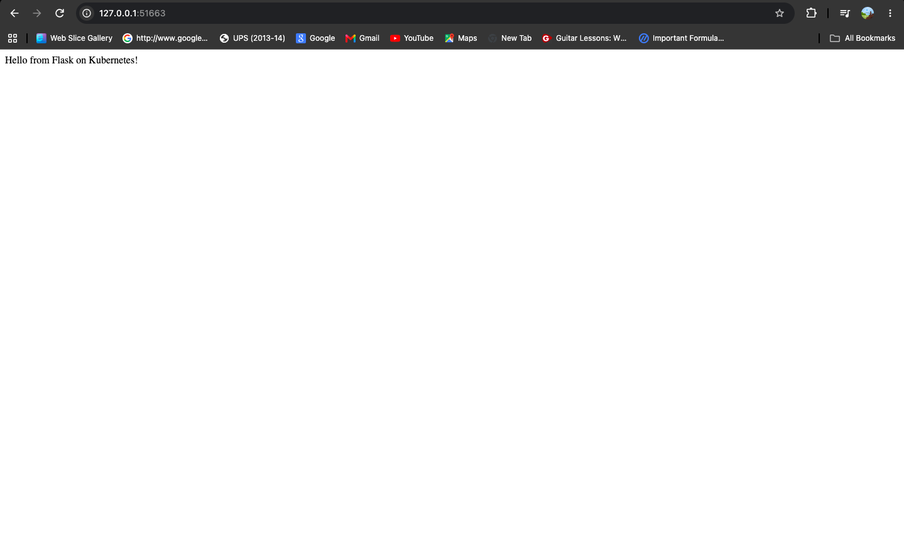
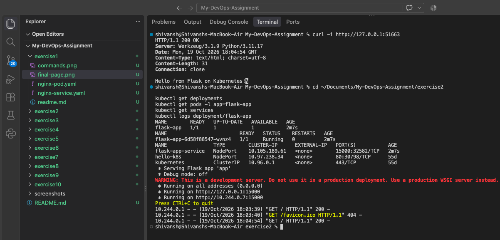

# Exercise 2 — Deploy a Flask App on Minikube using Kubernetes

## Objective

Build a Docker image for a Flask application, deploy it to Kubernetes
using Minikube, expose it through a NodePort Service, and verify the
application response.

---

## Final Result

The Flask application was successfully containerized and deployed as a
Kubernetes Deployment. Its Pod reached the Running state, and the
application was accessible through the Kubernetes Service.



---

## Commands Executed

The following commands were used to build the Docker image, make it
available to Minikube, deploy the application, and verify the resources.

```bash
docker build -t flask-app:latest .
minikube image load flask-app:latest
kubectl apply -f flask-deployment.yaml
kubectl rollout status deployment/flask-app --timeout=180s
kubectl get deployments
kubectl get pods -l app=flask-app
kubectl get services
kubectl logs deployment/flask-app
minikube service flask-app-service --url
```

The application endpoint was then tested with `curl`.



---

## Application Output

The application returned the following response:

```text
Hello from Flask on Kubernetes!
```

The HTTP response was `200 OK`, confirming that the application was
accessible through the Minikube Service.

---

## Files Created

- `app.py` — Flask application.
- `requirements.txt` — Python dependencies.
- `Dockerfile` — Instructions to build the container image.
- `flask-deployment.yaml` — Kubernetes Deployment and NodePort Service.
- `readme.md` — Exercise documentation.

---

## Conclusion

Successfully built a Docker image, deployed a Flask application to
Kubernetes using Minikube, exposed it through a NodePort Service,
and verified the response using HTTP.
