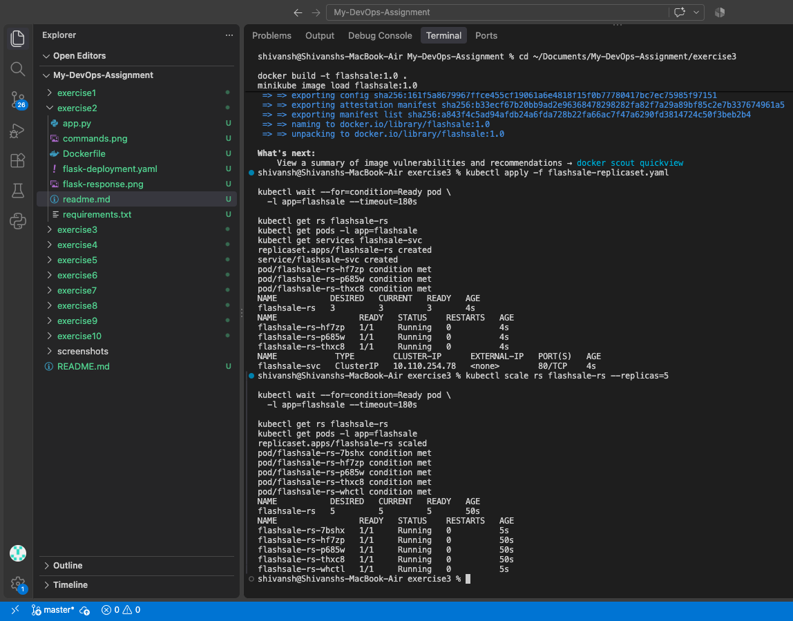
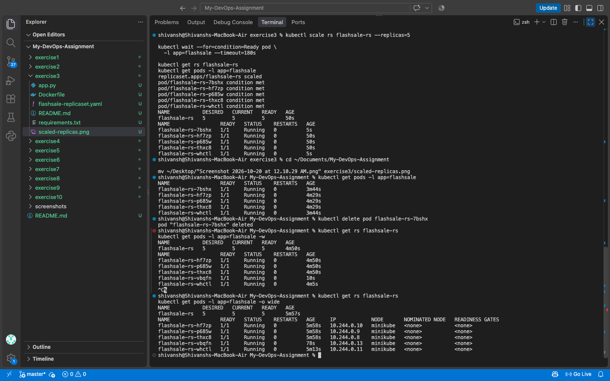

# Exercise 3 — Scaling a Flask App using ReplicaSets

## Objective

Deploy a Flask flash-sale application on Minikube using a Kubernetes
ReplicaSet, scale it from three to five replicas, and verify automatic
Pod replacement when a Pod is deleted.

---

## Final Result

The Flask application was successfully deployed. The ReplicaSet was
scaled to five replicas, and Kubernetes automatically replaced a deleted
Pod while maintaining the desired replica count.



---

## Commands Executed

The Docker image was built and loaded into Minikube. The ReplicaSet and
Service were created, and the application was scaled and verified.

```bash
docker build -t flashsale:1.0 .
minikube image load flashsale:1.0
kubectl apply -f flashsale-replicaset.yaml
kubectl get rs flashsale-rs
kubectl get pods -l app=flashsale
kubectl scale rs flashsale-rs --replicas=5
kubectl get pods -l app=flashsale -o wide
kubectl delete pod <pod-name>
kubectl get rs flashsale-rs
```

---

## Self-Healing Verification

After a Pod was deleted, the ReplicaSet created a replacement Pod.
The cluster returned to five ready replicas.



---

## Application Output

The application was tested through the Kubernetes Service using
port forwarding.

**Homepage**

```json
{"message":"Welcome to Big Sale!","pod":"flashsale-rs-hf7zp"}
```

**Purchase endpoint**

```json
{"item":"Laptop","served_by_pod":"flashsale-rs-hf7zp","status":"success","user":"123"}
```

**Health endpoint**

```json
{"pod":"flashsale-rs-hf7zp","status":"healthy"}
```

---

## Files Created

- `app.py` — Flask flash-sale application.
- `requirements.txt` — Python dependencies.
- `Dockerfile` — Container image configuration.
- `flashsale-replicaset.yaml` — ReplicaSet and Service definitions.
- `readme.md` — Exercise documentation.

---

## Conclusion

Successfully deployed a Flask application using Kubernetes ReplicaSets,
scaled it to five Pods, verified self-healing, and tested the application's
homepage, purchase, and health endpoints.
