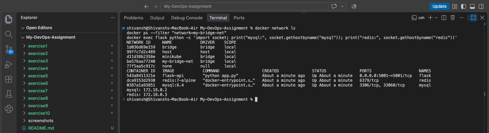
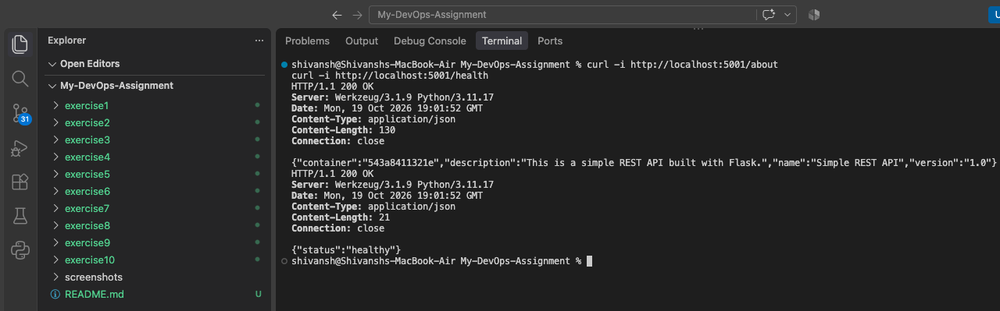

# Exercise 4 — Docker Networking with Multiple Containers

## Objective

Create a custom Docker bridge network and connect a Flask REST API,
MySQL database, and Redis cache to the same network. Verify communication
between containers using container names.

---

## Architecture

- **Flask:** REST API exposed on host port 5001.
- **MySQL:** Database container.
- **Redis:** Cache container.
- **Network:** Custom bridge network named `my-bridge-net`.

---

## Step 1 — Create and Inspect the Network

```bash
docker network create --driver bridge my-bridge-net
docker network ls
docker network inspect my-bridge-net
```

---

## Step 2 — Build the Flask Image

```bash
docker build -t flask-api .
```

---

## Step 3 — Launch the Containers

```bash
docker run -d --name mysql \
  --network my-bridge-net \
  -e MYSQL_ROOT_PASSWORD=devopsLab123 \
  -e MYSQL_DATABASE=appdb \
  mysql:8.4

docker run -d --name redis \
  --network my-bridge-net \
  redis:7-alpine

docker run -d --name flask \
  --network my-bridge-net \
  -p 5001:5001 \
  flask-api
```

---

## Step 4 — Verify Container Connectivity

```bash
docker exec flask ping -c 3 mysql
docker exec flask ping -c 3 redis
```

Both container names should resolve to addresses on the custom network.

---

## Step 5 — Test the Flask API

```bash
curl -i http://localhost:5001/about
curl -i http://localhost:5001/health
```

The `/about` endpoint should return the API details as JSON, and the
health endpoint should report a healthy status.

---

## Results

### Docker Network and Container Connectivity



### Flask API Response



---

## Questions and Answers

**1. What is the purpose of the `--network` flag in `docker run`?**

It connects a container to the specified Docker network.

**2. How do containers communicate on the same network?**

They can use container names or IP addresses. Docker's embedded DNS
resolves container names on user-defined bridge networks.

**3. What is the difference between bridge and host networking?**

A bridge network provides an isolated network for containers. Host
networking shares the host's network stack and removes network isolation
between the container and host.

**4. How can a container port be exposed to the host?**

Use the `-p` option, for example `-p 5001:5001`, to map host port 5001
to container port 5001.

---

## Conclusion

Created a custom Docker bridge network, connected Flask, MySQL, and Redis
containers, verified name-based container connectivity, and tested the
Flask REST API through a published port.
