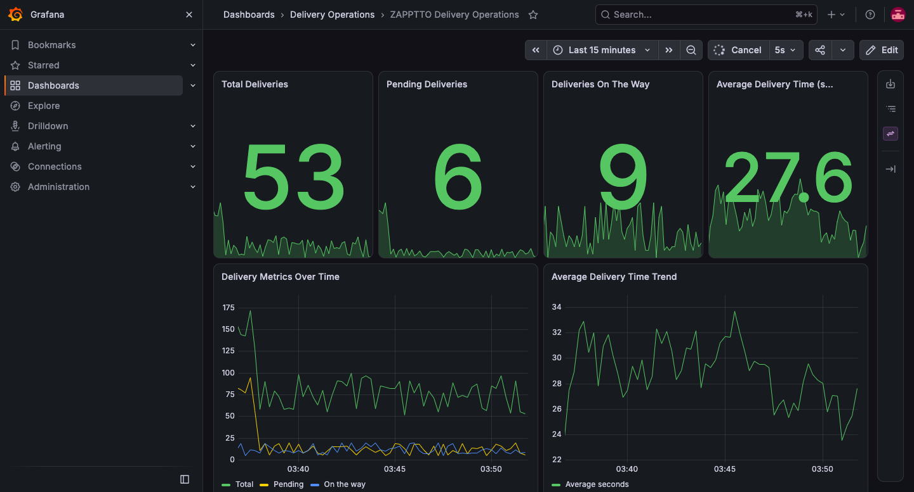
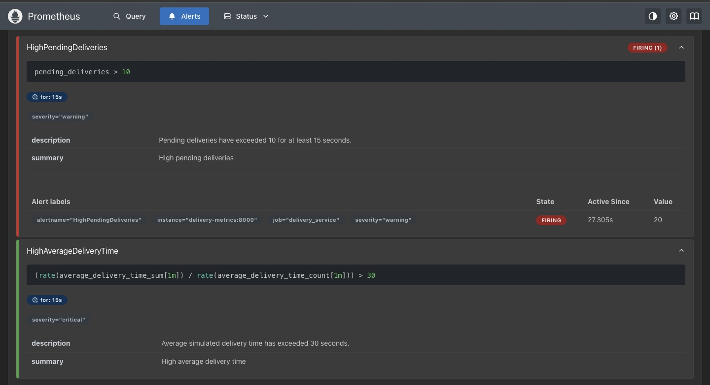
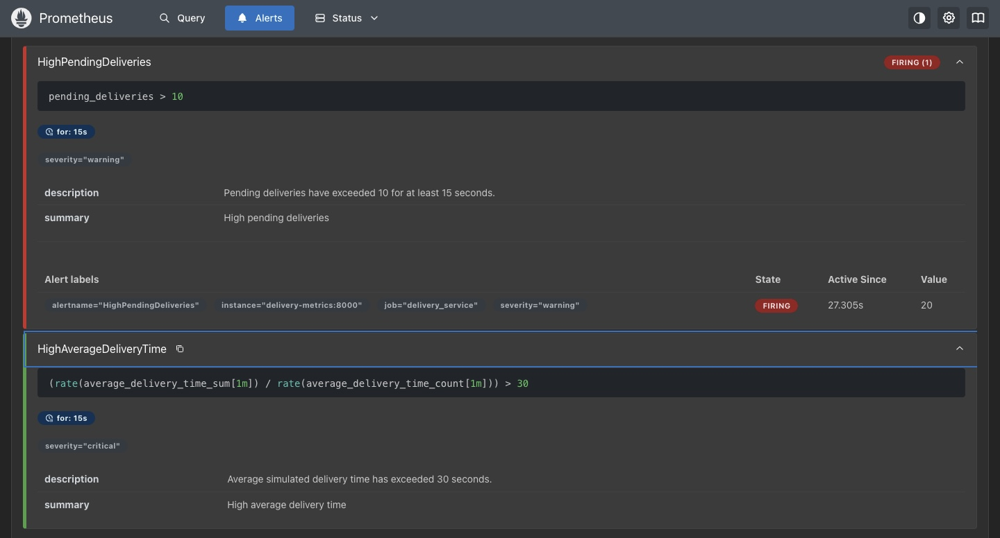

# Exercise 6 — Real-Time Operations Monitoring and Alerting

## Objective

Build a monitoring solution for the ZAPPTTO quick-commerce delivery service using Python, Prometheus, Grafana, Docker Compose, and a Jenkins pipeline.

## Architecture

Python delivery simulator → Prometheus metrics endpoint → Prometheus scraping and alert rules → Grafana dashboard.

Jenkins validates the project, builds the application image, starts the monitoring stack, and checks the metrics endpoint.

## Project Structure

- `delivery_metrics.py` — generates delivery metrics.
- `requirements.txt` and `Dockerfile` — Python dependencies and container image.
- `docker-compose.yml` — starts the metrics application, Prometheus, and Grafana.
- `prometheus.yml` — scrape configuration.
- `alert_rules.yml` — pending-delivery and delivery-time alerts.
- `grafana-provisioning/` — Prometheus data source and dashboard provisioning.
- `Jenkinsfile` — pipeline stages.
- `grafana-dashboard.png` — live Grafana dashboard screenshot.
- `prometheus-alerts-pending.jpg` — Prometheus pending-alert evidence.
- `prometheus-alerts-firing.jpg` — Prometheus firing-alert evidence.

## Start the Monitoring Stack

From this directory:

```bash
docker compose config
docker compose up -d --build
docker compose ps
```

## Verify the Metrics

```bash
curl -fsS http://localhost:8000/metrics | grep -E '^(total_deliveries|pending_deliveries|on_the_way_deliveries|average_delivery_time_)'
```

Open these local services:

- Metrics: http://localhost:8000/metrics
- Prometheus: http://localhost:9090
- Prometheus targets: http://localhost:9090/targets
- Prometheus alerts: http://localhost:9090/alerts
- Grafana: http://localhost:3000

Grafana's default initial credentials are `admin` / `admin`. Change the password if prompted. The provisioned dashboard is named **ZAPPTTO Delivery Operations**.

## Alert Rules

- `HighPendingDeliveries`: pending deliveries remain above 10 for 15 seconds.
- `HighAverageDeliveryTime`: the rolling average delivery time remains above 30 seconds for 15 seconds.

The application uses randomized sample data; these metrics demonstrate monitoring mechanics rather than real customer operations.

## Simulate a High-Pending Alert

Stop the current stack and restart with high pending deliveries enabled:

```bash
docker compose down
SIMULATE_HIGH_PENDING=1 docker compose up -d --build
```

Wait at least 30 seconds, then inspect http://localhost:9090/alerts and the Grafana dashboard. To return to normal simulation:

```bash
docker compose down
docker compose up -d --build
```

## Jenkins Pipeline

The `Jenkinsfile` contains pre-check, configuration validation, image build, stack deployment, and metrics verification stages. Run it from a Jenkins Pipeline job whose execution environment has Python 3, Docker CLI, Docker Compose, access to the Docker daemon, and the project files in its workspace. A Jenkinsfile alone does not mean a Jenkins build has run; record a successful build only after executing it.

## Cleanup

```bash
docker compose down
```

Persistent Prometheus and Grafana data volumes are retained. To remove those volumes too, use `docker compose down -v`.

## Screenshots

All screenshots are stored directly in the `exercise6/` directory.

### Grafana Dashboard


### Prometheus Alert — Firing


### Additional Prometheus Alert Evidence



## Result

Complete this section after running the stack and validating the endpoints, targets, dashboard, alert behavior, and Jenkins pipeline. Do not mark components successful until their results have been observed.
