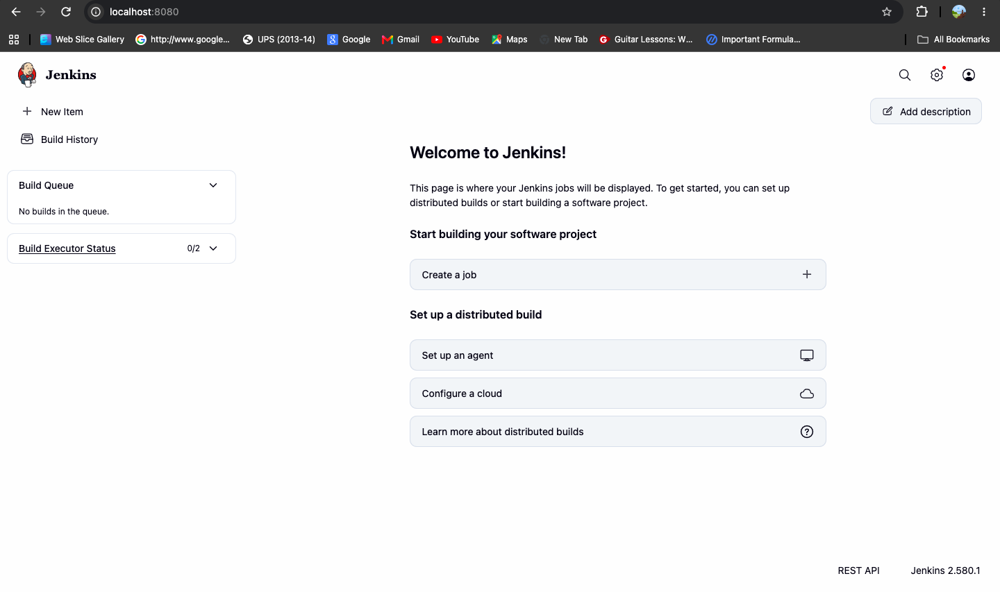

# Exercise 7: Jenkins CI Automation

## Aim

To understand Continuous Integration (CI), install and configure Jenkins
using Docker, and verify that the Jenkins dashboard is accessible.

## Objectives

- Understand the purpose of Continuous Integration.
- Learn how Jenkins automates software development workflows.
- Run Jenkins in a Docker container.
- configure persistent Jenkins storage and publish the required ports.
- Complete the initial Jenkins setup and verify the web interface.

## Tools and Technologies

- Docker Desktop
- Jenkins (official `jenkins/jenkins:lts` image)
- macOS Terminal
- Web browser

## Concepts

### Continuous Integration

Continuous Integration is a development practice in which code changes
are integrated frequently and checked through automated build and test
processes. It helps detect integration problems earlier and provides
faster feedback to developers.

### Jenkins

Jenkins is an automation server that supports build, test, and delivery
workflows through jobs, pipelines, and plugins.

### Docker

Docker runs Jenkins in an isolated container. A named volume preserves
Jenkins configuration and other home-directory data when the container
is restarted.

## Implementation

### 1. Start Jenkins

The following command was used to run Jenkins:

```bash
docker run -d \
  --name jenkins \
  --restart unless-stopped \
  -p 8080:8080 \
  -p 50000:50000 \
  -v jenkins_home:/var/jenkins_home \
  jenkins/jenkins:lts
```

The published ports are:

- `8080`: Jenkins web interface.
- `50000`: Jenkins inbound agent connection port.

The `jenkins_home` Docker volume stores Jenkins data persistently.

The equivalent setup procedure is documented in `setup-jenkins.sh`.
It checks for an existing container before attempting to create one.

### 2. Complete the initial setup

1. Check the container logs until Jenkins finishes starting.
2. Retrieve the initial administrator password when prompted by the
   setup wizard:

   ```bash
   docker exec -it jenkins \
     cat /var/jenkins_home/secrets/initialAdminPassword
   ```

3. Open `http://localhost:8080` in a browser.
4. Complete the setup wizard, install the suggested plugins, and create
   the administrator account.
5. Open the Jenkins dashboard.

Do not store the administrator password in this repository.

### 3. Verify the installation

Check the container:

```bash
docker ps --filter "name=^/jenkins$"
```

Inspect the startup logs:

```bash
docker logs --tail 30 jenkins
```

Check the HTTP response:

```bash
curl -sS -o /dev/null -w "HTTP status: %{http_code}\n" \
  --max-time 10 http://localhost:8080/login
```

The installation was verified during setup:

- The Jenkins container was running.
- The container published ports `8080` and `50000`.
- Jenkins reported that it was fully up and running.
- The login endpoint returned HTTP `200`.
- The Jenkins dashboard was accessible in the browser.

Run `./verify-jenkins.sh` to repeat these checks.

## Screenshot Evidence

### Jenkins Dashboard

The following screenshot was captured from the running Jenkins instance.



## Files

| File | Purpose |
|---|---|
| `README.md` | Exercise procedure, concepts, and verification evidence |
| `setup-jenkins.sh` | Reproducible, existing-container-aware setup script |
| `verify-jenkins.sh` | Container, port, log, and HTTP checks |
| `jenkins-dashboard.png` | Screenshot of the configured Jenkins dashboard |

## Result

Jenkins was installed and configured in Docker. The container was
verified as running, the web endpoint returned HTTP `200`, and the
dashboard was accessed successfully.

This exercise establishes the Jenkins environment. Creating and running
a separate CI job or pipeline should be documented with the corresponding
evidence in the exercise that requires it.
