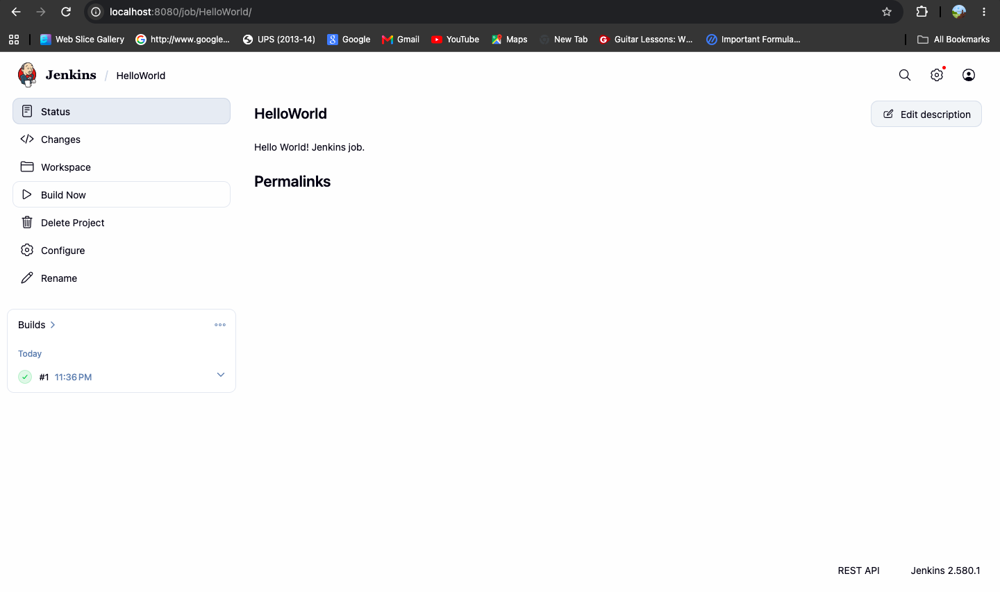
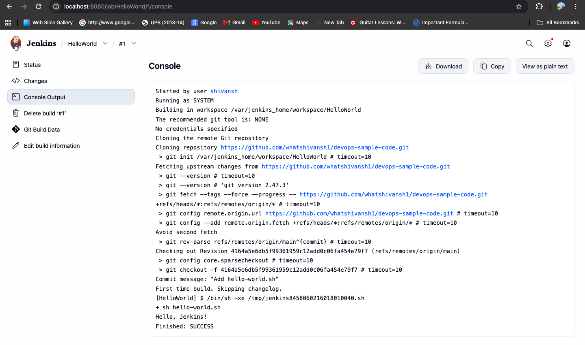

# Exercise 8: Jenkins Hello World Job

## Aim

To create a shell script in a Git repository and configure a Jenkins
Freestyle project to execute the script and display its output.

## Objectives

- Create and execute a shell script.
- Understand the connection between source control and Jenkins.
- Configure a Jenkins Freestyle job.
- Execute a build and inspect its Console Output.

## Tools and Technologies

- Git and GitHub
- Jenkins
- Docker
- Bash shell

## Implementation

### 1. Create the Hello World script

The file `hello-world.sh` contains:

```bash
#!/bin/bash
set -eu

echo "Hello, Jenkins!"
```

Make the script executable and test it locally:

```bash
chmod +x hello-world.sh
./hello-world.sh
```

Expected output:

```text
Hello, Jenkins!
```

### 2. Prepare the GitHub repository

The original assignment asks for a separate public repository named
`devops-sample-code`.

1. Create the repository on GitHub.
2. Configure Git authentication using a secure method, such as GitHub CLI
   or a personal access token.
3. Push `hello-world.sh` to the repository's `main` branch.

Run the following commands from this exercise directory only after
creating the remote repository. Replace the placeholder URL with your
own repository URL.

```bash
git init
git add hello-world.sh
git status
git commit -m "Add hello-world.sh"
git branch -M main
git remote add origin https://github.com/YOUR_USERNAME/devops-sample-code.git
git push -u origin main
```

Do not place a personal access token in this repository or in this README.
If this directory has already been initialized as a Git repository,
inspect `git status` and `git remote -v` before running initialization
or remote configuration commands again.

### 3. Confirm Jenkins is running

Open Jenkins at:

http://localhost:8080

Confirm that the Jenkins dashboard is accessible and sign in.

### 4. Create a Freestyle project

1. Select **New Item** on the Jenkins dashboard.
2. Enter `HelloWorld` as the item name.
3. Select **Freestyle project** and click **OK**.
4. Add the description `Hello World! Jenkins job.`
5. Under **Source Code Management**, select **Git**.
6. Enter the URL of your `devops-sample-code` repository.
7. Under **Build Steps**, select **Add build step → Execute shell**.
8. Enter the following build command:

   ```bash
   sh hello-world.sh
   ```

9. Save the job.

The Jenkins environment must be able to access the repository and run
the shell command.

### 5. Run and verify the job

1. Open the `HelloWorld` job.
2. Click **Build Now**.
3. Open the resulting build number in **Build History**.
4. Select **Console Output**.

Expected output includes:

```text
Hello, Jenkins!
Finished: SUCCESS
```

A successful build confirms that Jenkins checked out the repository,
executed the shell script, and completed the build without errors.

## Verification

### Local script verification

Run:

```bash
./hello-world.sh
```

Expected output:

```text
Hello, Jenkins!
```

### Jenkins verification

The Jenkins job is verified only after an actual build completes
successfully and its Console Output contains `Hello, Jenkins!`.

## Screenshot Evidence

The following screenshots provide evidence of the successful Jenkins build.

### Jenkins Job — Successful Build



### Jenkins Console Output

The console confirms that the script printed `Hello, Jenkins!` and the build
finished with `SUCCESS`.



## Files

| File | Purpose |
|---|---|
| `hello-world.sh` | Shell script executed by Jenkins |
| `README.md` | Setup instructions and verification procedure |
| `jenkins-job-success.png` | To be captured after a successful build |
| `jenkins-console-output.png` | To be captured after inspecting Console Output |

## Result

The Hello World script has been created for the exercise. The script was pushed to the separate GitHub repository, configured in
Jenkins as a Freestyle project, and executed successfully. The Console
Output displayed `Hello, Jenkins!` and `Finished: SUCCESS`.
