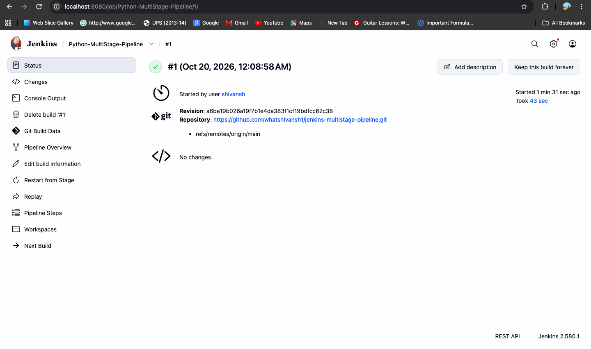
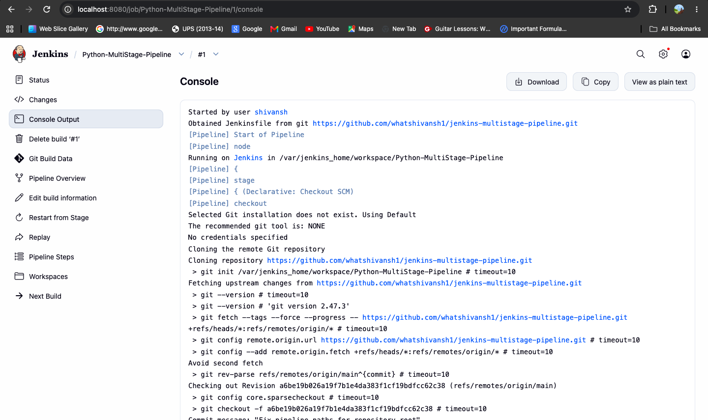
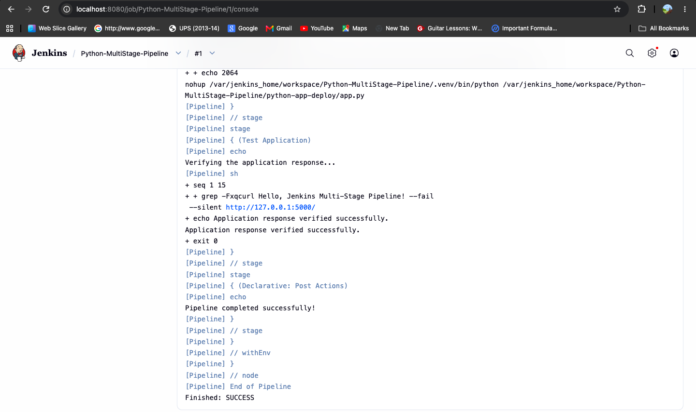

# Exercise 9: Jenkins Multi-Stage Pipeline

## Objective

Build and execute a Jenkins Declarative Pipeline for a Python Flask application using multiple CI/CD stages.

## Application

The Flask application's home route (`/`) returns:

`Hello, Jenkins Multi-Stage Pipeline!`

## GitHub Repository

Source code and Jenkinsfile: [jenkins-multistage-pipeline](https://github.com/whatshivansh1/jenkins-multistage-pipeline)

## Pipeline Stages

1. **Build** — Create a Python virtual environment and install dependencies.
2. **Test** — Run unit tests using Python's `unittest` framework.
3. **Deploy** — Copy the application files to a mock deployment directory.
4. **Run Application** — Start the Flask application.
5. **Test Application** — Verify the HTTP response from the running application.

## Execution Evidence

### 1. Successful Jenkins Build

Build #1 completed successfully.

### 2. Pipeline Console Output

The console confirms the repository checkout and pipeline execution.

### 3. Application Verification

The application response was verified, and the pipeline finished with `SUCCESS`.

## Result

**Status: SUCCESS**

The multi-stage Jenkins pipeline successfully built the Python environment, ran the unit tests, deployed the application to a mock directory, started the Flask application, and verified its response.
